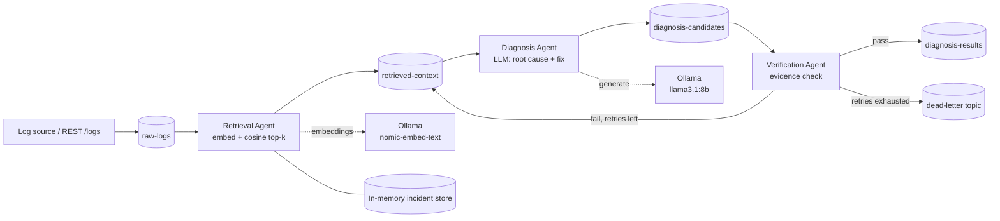

# Log Agents: Event-Driven Multi-Agent Log Diagnosis

A local, Kafka-backed pipeline where specialised LLM agents retrieve similar past incidents, propose a root cause, and verify the diagnosis against the evidence before publishing it. Runs fully offline on a laptop using Ollama (no API keys, no cloud).

> All incidents and logs in this repo are synthetic.

## Architecture

## Components

| Component | Responsibility |
|---|---|
| Kafka (Docker, KRaft) | Durable, decoupled handoff between stages |
| Ingest API | Accepts log lines and publishes to `raw-logs` |
| Retrieval Agent | Embeds the log, finds the top-k similar past incidents (RAG) |
| Diagnosis Agent | Prompts the LLM with log + retrieved cases, returns structured JSON |
| Verification Agent | Confirms the diagnosis cites evidence actually present in the log; triggers a retry loop otherwise |
| Ollama | Local inference server for the chat and embedding models |

## Message flow

Each message carries a correlation ID, the raw log, retrieved incidents, the candidate diagnosis, and an attempt counter, so every stage is traceable end to end.

## Design decisions

- **Event-driven stages over a single prompt:** each agent scales, fails, and retries independently.
- **RAG for grounding:** the model sees real, similar incidents instead of guessing generically.
- **Verification as a first-class stage:** LLM output is treated as untrusted until checked.
- **Bounded retries and a dead-letter topic:** failures are visible, never silently dropped.
- **Local-first:** Ollama keeps all data on the machine.

## Tech stack

Java, Spring Boot, Spring for Apache Kafka, Apache Kafka (Docker), Ollama (llama3.1:8b, nomic-embed-text)

## Running locally

1. `docker compose up -d` (starts Kafka)
2. `ollama pull llama3.1:8b` and `ollama pull nomic-embed-text`
3. `mvn spring-boot:run`
4. `POST http://localhost:8080/logs` with a log line as the body

## Status

- [x] Kafka broker and topics
- [x] Ingest API and consumer skeleton
- [x] Ollama client (embeddings and generation)
- [ ] Incident store and cosine-similarity retrieval
- [ ] Diagnosis agent with structured output
- [ ] Verification agent and retry loop
- [ ] Dead-letter topic
- [ ] Synthetic incident dataset and demo script

## Future work

Swap the in-memory store for a vector database (pgvector or Qdrant), add metrics (end-to-end latency, retry rates), and an evaluation harness comparing diagnoses against known root causes.